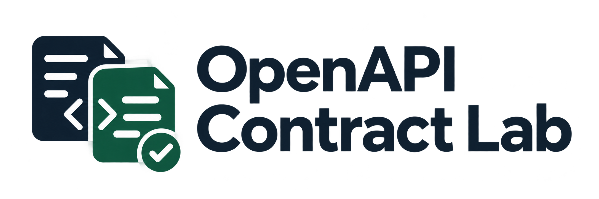

# openapi-contract-lab



> Candidato v1.0.0 para revisión: contrato CLI/JSON documentado, trece explicaciones, informes locales y política de severidad. Solo Windows x64 y corpus OpenAPI acotado. No publicado; versión pública vigente v0.2.0 experimental.

La [prerelease v0.2.0](https://github.com/v1kz25/openapi-contract-lab/releases/tag/v0.2.0) está publicada y sincronizada a `develop` mediante #34/#35. Las [notas v0.2.0](docs/releases/v0.2.0.md) y [preparación #33](docs/CANDIDATE-V0.2.0.md) conservan su redacción histórica de candidato; para instalar usar la [guía vigente](docs/INSTALL.md). v0.1.0, sus notas y archivos conservan sus diez explicaciones originales. `release/1.0.0` prepara el [candidato #40](docs/releases/v1.0.0.md), identificado como v1.0.0 y distinto del ZIP público. Contrato estable propuesto para CLI 1.x/JSON v1; sus garantías entrarán en vigor al aprobar y publicar v1.0.0.

Explica cambios incompatibles entre contratos OpenAPI usando oasdiff, con informes locales y CI.

## Objetivo

Comparar dos especificaciones OpenAPI sin reimplementar el análisis semántico; enriquecer hallazgos con explicación determinista y generar informes offline.

## Stack

Go 1.27.4, sin módulos externos. La comparación ejecuta el binario local oasdiff 1.39.0 (Apache-2.0), cuya versión se comprueba antes de comparar.

## Uso disponible

Para empezar desde cero en Windows x64, ver [instalación, actualización y reversión](docs/INSTALL.md). [v0.2.0 experimental](https://github.com/v1kz25/openapi-contract-lab/releases/tag/v0.2.0) ofrece ZIP y checksums; no requiere SDK Go para ejecutarse. oasdiff 1.39.0 se obtiene por separado. Solo compilar desde fuente necesita Go 1.27.4; herramientas/hashes fijados, sin instalación global, instalador ni actualizador automático.

Desde la raíz del repositorio, con Go 1.27.4 y el motor local ya preparados:

```powershell
go run ./cmd/openapi-contract-lab --help
go run ./cmd/openapi-contract-lab --version
go build -trimpath -buildvcs=false -o dist/openapi-contract-lab.exe ./cmd/openapi-contract-lab
./dist/openapi-contract-lab.exe --help
./dist/openapi-contract-lab.exe compare --oasdiff ./dist/oasdiff-1.39.0/oasdiff.exe ./spikes/oasdiff/fixtures/base.yaml ./spikes/oasdiff/fixtures/required.yaml
$LASTEXITCODE # 3: informe generado; breaking change
```

Sin argumentos muestra ayuda. En esta rama de candidato, `--version` devuelve `openapi-contract-lab v1.0.0`; no implica publicación. Un comando desconocido devuelve un mensaje en stderr y código 2. La CLI no inicia un servidor ni una interfaz gráfica. Las [notas v0.1.0](docs/releases/v0.1.0.md) describen únicamente los archivos de aquella versión publicada.

Para comparar, preparar el binario oficial según el [spike](docs/OASDIFF-SPIKE.md). `--oasdiff` puede omitirse si oasdiff está en PATH. Las dos entradas deben ser archivos locales; se deshabilitan las referencias externas. La salida conserva rule ID, severidad, ruta, ubicaciones y el evento original. Ver [modelo y pruebas del adaptador](docs/OASDIFF-ADAPTER.md).

Cada hallazgo incluye `explanation` con resumen, impacto, acción sugerida y ubicaciones. Las [trece combinaciones verificadas en v0.2.0](docs/EXPLANATIONS.md) tienen texto determinista en español; otras reglas, niveles o versiones reciben un fallback neutral. La explicación conserva la clasificación de oasdiff y añade enlaces locales solo para fuentes que coinciden con las entradas conocidas.

La salida JSON utiliza escapes Unicode para que Windows PowerShell 5.1 conserve los acentos incluso con codificaciones de consola antiguas. `ConvertFrom-Json` recupera el texto original; no hace falta cambiar la configuración global de Windows.

Para exportar un informe local, elegir un archivo nuevo:

```powershell
./dist/openapi-contract-lab.exe compare --oasdiff ./dist/oasdiff-1.39.0/oasdiff.exe --format html --output dist/revision.html ./spikes/oasdiff/fixtures/base.yaml ./spikes/oasdiff/fixtures/required.yaml
```

`--format` admite `json` (predeterminado), `markdown` y `html`. `--output` escribe UTF-8 directamente y evita la redirección de PowerShell; rechaza destinos existentes. El HTML incluye todo lo necesario, sin servidor, scripts ni recursos de red. Ver [exportación y pruebas](docs/REPORTS.md).

Desde v0.2.0, HTML y Markdown agrupan por ruta/método y severidad, con resumen por grupo y sección para hallazgos sin ruta u operación. JSON conserva campos y orden upstream. Los [ejemplos comparables](docs/REPORTS.md#ejemplos-comparables-y-revisión-manual-del-issue-23) muestran la presentación anterior y la agrupada; v0.1.0 publicada mantiene la lista plana.

Por defecto, los hallazgos `error` (breaking) devuelven **3 después de generar el informe**. `--fail-on error|warning|info|none` permite cambiar el umbral; `none` conserva el comportamiento de exportación sin gate. Severidades desconocidas bloquean con cualquier política activa. Los fallos operativos devuelven 1 y los argumentos inválidos 2. Ver [política y ejemplos PowerShell](docs/SEVERITY-POLICY.md).

Una lista vacía de hallazgos no implica que los contratos sean idénticos: los cambios solo de descripción no aparecen en el changelog.

## Funciones disponibles y límites

- Comparación de dos archivos locales mediante oasdiff 1.39.0. Regresión probada con fixtures 3.0.3 y [cinco pares acotados 3.1.0](docs/OPENAPI31-REGRESSION.md), incluidos unión con null y propiedad de respuesta; no se afirma cobertura completa de 3.1 ni soporte verificado de 3.2. v0.1.0 publicada conserva su corpus mínimo original.
- Clasificación conservada del motor y trece explicaciones deterministas en español en v0.2.0 (diez en v0.1.0); fallback neutral para otras reglas/niveles.
- Informes JSON/Markdown/HTML offline y gate configurable por severidad. Timeout de comparación de 30 segundos; referencias externas y entradas URL/UNC deshabilitadas.
- Solo Windows x64 verificado; PowerShell 5.1 y 7. Contrato CLI 1.x/JSON v1 documentado en el candidato, sin nuevo campo de esquema; v0.2.0 publicada conserva su carácter experimental. Sin GUI, comparación por carpetas, editor ni autofix.

### Fuera del MVP

- motor propio de diff
- LLM o API de pago
- editor de contratos completo
- autofix/Overlays automáticos generales
- servicio cloud

## Desarrollo

- Ver [roadmap](docs/ROADMAP.md), [guía de desarrollo](docs/DEVELOPMENT.md) y [AGENTS.md](AGENTS.md).
- El punto de entrada son los GitHub Issues, no implementar el MVP de golpe.
- Spike local de oasdiff (issue #1): [decisión, ejemplos y evidencia](docs/OASDIFF-SPIKE.md). No es una CLI del proyecto.
- Desarrollo principalmente desde Windows 11; sin infraestructura de pago. [Mantenimiento y reporte sintético de problemas](docs/DEVELOPMENT.md#mantenimiento-y-reporte-de-problemas), sin publicar contratos privados ni prometer SLA universal.
- [CI y regresión](docs/CI.md): runner estándar Windows, versiones fijadas, pruebas reales con oasdiff y análisis estático. El mismo script se puede ejecutar localmente.
- [Publicación y empaquetado](docs/RELEASE.md): v0.2.0 publicada y proceso de revisión para futuras versiones. `scripts/smoke.ps1` comprueba el ejecutable ya compilado sin SDK ni descargas. El [roadmap hacia v1.0.0](docs/ROADMAP.md) distingue tareas propuestas de funciones disponibles.
- [Investigación de tipos de cambio](docs/CHANGE-KIND-SPIKE.md): evidencia sobre `diff`/`summary`/`changelog` y límites para inferir igualdad o cambios solo documentales. La clasificación no está implementada.

## Riesgos

Mapear los hallazgos de oasdiff a un modelo estable, diferencias entre OpenAPI 3.0/3.1/3.2, y evitar explicaciones inexactas.

## Referencias

- https://github.com/oasdiff/oasdiff
- https://spec.openapis.org/overlay/

## Licencia

[Apache-2.0](LICENSE), elegida explícitamente por el propietario. Conservar [NOTICE](NOTICE) y los [avisos de terceros](THIRD_PARTY_NOTICES.txt) al redistribuir los archivos correspondientes. El binario incluye runtime/biblioteca estándar Go (BSD-3-Clause); oasdiff 1.39.0 (Apache-2.0) se obtiene por separado.
